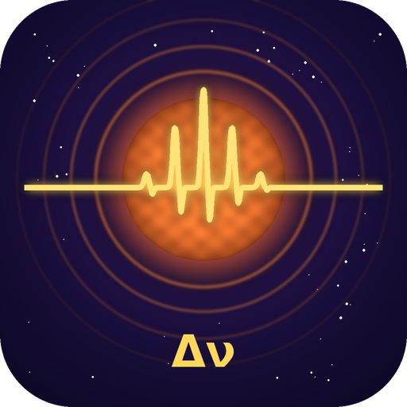

<p align="center"></p>

# Heartbeat of the Stars

*Asteroseismology at home: νmax, Δν, mass, radius and age of oscillating stars from Kepler and TESS* — original Italian name: «Il battito delle stelle»

Sun-like stars and red giants vibrate: their light changes by a few parts per million with periods of minutes to days. This program downloads Kepler and TESS light curves from MAST, cleans them, computes the power spectrum and measures **νmax** (where the oscillations are strongest) and **Δν** (the regular spacing of the peaks). With the temperature and metallicity it derives mass, radius, gravity, density and luminosity from the scaling relations, the age and evolutionary phase from MIST tracks, compares with published catalogues, and even lets you **listen** to the star.

## Features

* Kepler 30-min / 1-min (including special apertures of very bright stars) and TESS 2-min / 20-s / full-frame light curves
* Weighted power spectrum, comb and excess detection, folding for mixed modes; verdict *sure / probable / doubtful / out of reach*
* Teff and [Fe/H] from APOKASC, Yu et al. 2018, TIC or Gaia DR3; age and phase (RGB or red clump) from MIST
* Comparison with APOKASC-3, APOKASC-2 and Yu et al. 2018; *Find stars…* picks suitable targets
* PDF/PNG card and CSV in English, WAV sound of the star

## Tested on real data

Validated on real stars: KIC 757137 νmax 30.1 µHz / Δν 3.390 µHz (Yu+2018: 29.99 / 3.399); 16 Cyg A 2225 / 103.48 (literature ≈ 2188 / 103.78); KIC 11026764 895 / 50.34 (≈ 900 / 50.5); ν Indi (TESS) 347 / 25.37 (≈ 340 / 25.14).

> **Language note.** The interface is in **Italian** (large, adjustable text); plots, PDF/PNG cards and scientific output are in **English**. Code comments are in Italian. The original Italian guide is [`LEGGIMI.txt`](LEGGIMI.txt).

**Version:** 1.16 (2026-11-19). **Status:** Stable: 1.16 built, self-test passed.

## Quick start

Requirements: Python 3.10+ (tested with Python 3.14 on Ubuntu) with `tkinter` (Ubuntu: `sudo apt install python3-tk`).

```bash
git clone https://github.com/EDOKILLER/heartbeat-of-the-stars.git
cd heartbeat-of-the-stars
python3 -m pip install -r requirements.txt

python3 battito_stelle.py --autotest
python3 battito_stelle.py --analizza "KIC 757137"   # terminal only, no window
python3 battito_stelle.py        # opens the window
```

### Standalone executable

`bash crea_eseguibile_ubuntu.sh` builds a single-file executable with PyInstaller in a temporary virtual environment, runs the self-test, and adds the program with its icon to the application menu and the desktop (first time on GNOME: right-click → *Allow launching*).

The build scripts were written for the author's machine: check the paths at the top before running them.

## Data sources and acknowledgements

Data are downloaded at run time from public services. If you publish results, please follow their acknowledgement policies:

* [Mikulski Archive for Space Telescopes (STScI): Hubble, JWST, Kepler, TESS, GALEX, Pan-STARRS](https://archive.stsci.edu/)
* [VizieR catalogue service, CDS, Strasbourg (the Harvard mirror is used)](https://vizier.cds.unistra.fr/)
* [ESA Gaia archive](https://gea.esac.esa.int/archive/)
* [MESA Isochrones and Stellar Tracks](https://waps.cfa.harvard.edu/MIST/)

This project is independent and not endorsed by any of these institutions.

## License

Code: [BSD 3-Clause](LICENSE) © 2026 Edoardo Battistel. You can use, modify and redistribute it, also commercially, as long as you keep the copyright notice; the author's name may not be used to promote derived works without permission. If you use it in research, see [`CITATION.cff`](CITATION.cff).

---
Part of a series of astronomy programs by Edoardo Battistel — see also [X-rays from Black Holes](https://github.com/EDOKILLER/x-rays-from-black-holes) and the other repositories on [this profile](https://github.com/EDOKILLER?tab=repositories).
